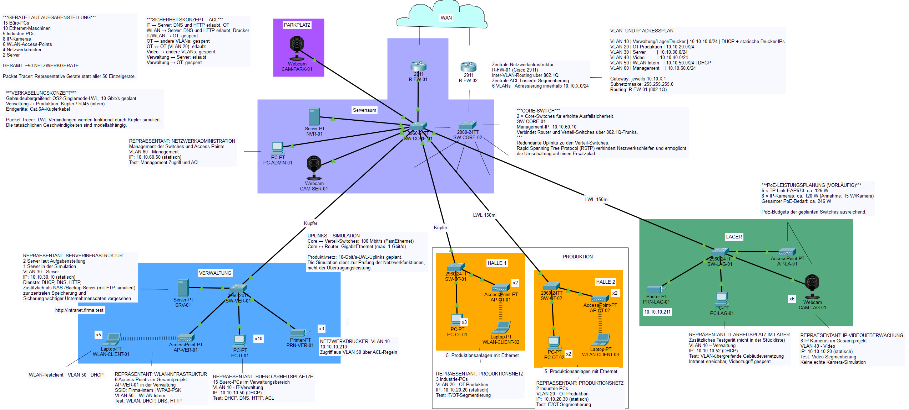
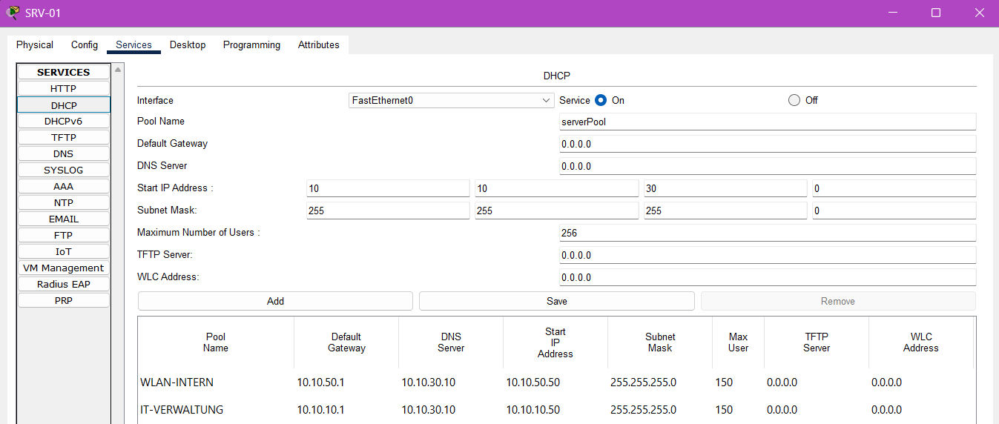
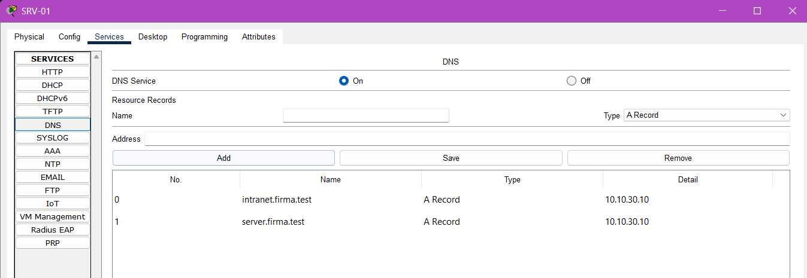
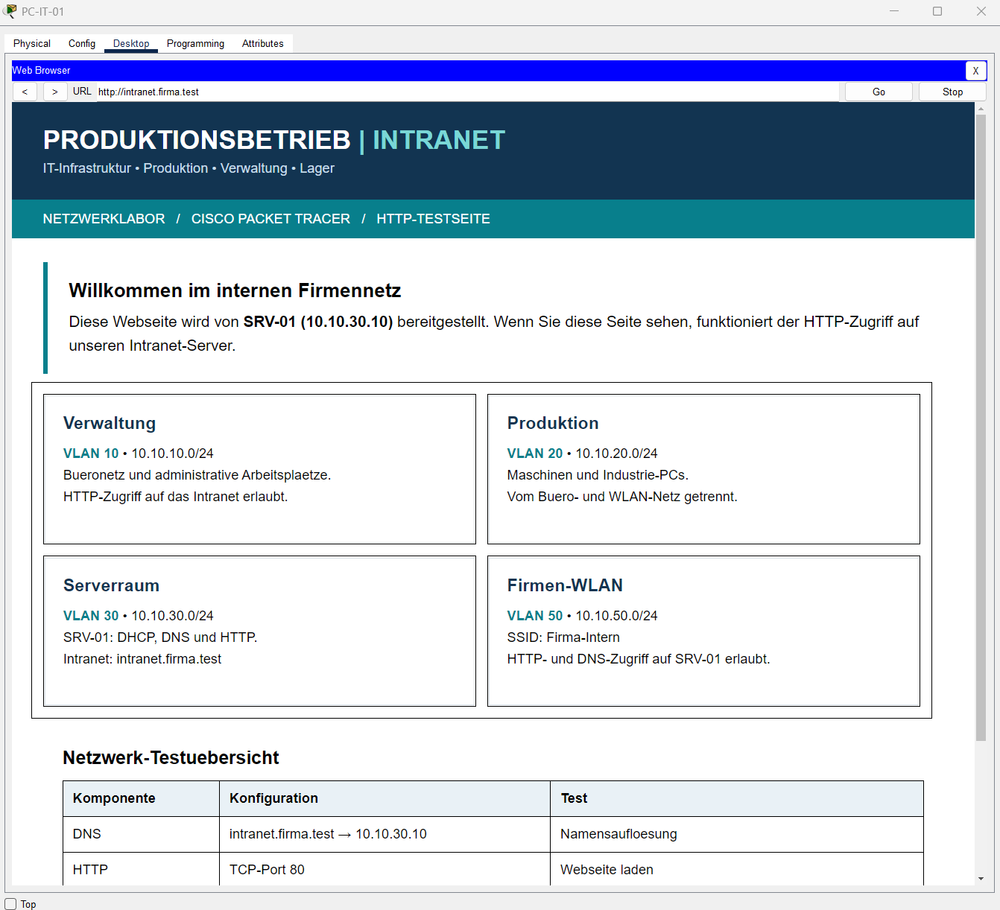
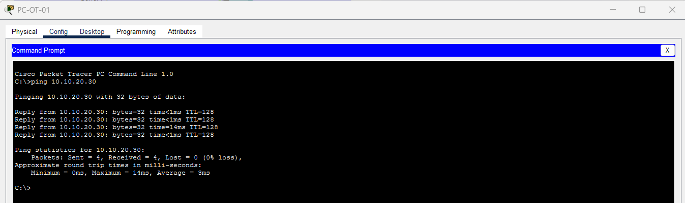
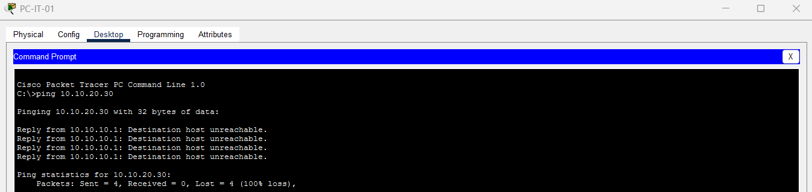

# Industrial IT/OT Network Lab

A simulated network infrastructure for a manufacturing company, designed and implemented in Cisco Packet Tracer as part of my vocational retraining as an IT specialist in system integration (Fachinformatiker für Systemintegration).

## Project Overview

The project represents a manufacturing company with an administration department, two production halls, a warehouse and a server room.

The main objective is to separate corporate IT and operational technology (OT) networks while providing controlled access to shared network services.

## Technologies and Concepts

- Cisco Packet Tracer

- Cisco IOS

- IPv4 addressing and subnetting

- VLAN segmentation

- IEEE 802.1Q trunking

- Router-on-a-Stick

- Inter-VLAN routing

- Extended Access Control Lists (ACLs)

- Centralized DHCP and DHCP Relay

- DNS and HTTP services

- WLAN with WPA2-PSK and AES

- Management VLAN and SSH configuration

- Spanning Tree Protocol (PVST)

## My Contribution

This simulation was developed as part of a group training project.

I independently created and configured the Cisco Packet Tracer network, including the router, switches, access points, server services and end devices.

My responsibilities included:

- Designing the simulated network topology

- Creating the IPv4 addressing and VLAN structure

- Configuring Cisco IOS devices

- Implementing inter-VLAN routing

- Configuring ACL-based network segmentation

- Setting up DHCP, DNS and HTTP services

- Configuring wireless access points

- Testing and troubleshooting network connectivity

This repository focuses on my individual technical implementation rather than the complete group project.

## Network Architecture

The active simulated infrastructure consists of one Cisco 2911 router, five Cisco Catalyst 2960 switches, wireless access points, a central server and representative end devices.

The core switch connects the administration department, both production halls and the warehouse.

Inter-VLAN routing is implemented through router subinterfaces using IEEE 802.1Q encapsulation.

## VLAN and IP Addressing

| VLAN | Purpose | Subnet | Gateway |
|---|---|---|---|
| 10 | IT / Administration | 10.10.10.0/24 | 10.10.10.1 |
| 20 | OT / Production | 10.10.20.0/24 | 10.10.20.1 |
| 30 | Servers | 10.10.30.0/24 | 10.10.30.1 |
| 40 | Video Surveillance | 10.10.40.0/24 | 10.10.40.1 |
| 50 | Internal WLAN | 10.10.50.0/24 | 10.10.50.1 |
| 60 | Management | 10.10.60.0/24 | 10.10.60.1 |
| 999 | Unused Native VLAN | — | — |

Trunk ports are configured with restricted allowed VLAN lists according to the requirements of each network area.

## Network Security

Extended ACLs are applied to router subinterfaces to control routed traffic between VLANs.

The configured rules include:

- DNS and HTTP access from IT and WLAN to the central server

- Isolation of the OT network from other routed networks

- Restricted WLAN access to network printers

- Restrictions on routed traffic originating from the video surveillance network

- Server access from the designated administration workstation

- Implicit or explicit deny rules for traffic without matching permissions

SSH version 2 and a dedicated management IP address are configured on the core switch.

## Network Services

The central server SRV-01 uses the static IP address `10.10.30.10`.

### DHCP

| Network | Address Range | Maximum Clients |
|---|---|---|
| IT | 10.10.10.50–10.10.10.199 | 150 |
| WLAN | 10.10.50.50–10.10.50.199 | 150 |

DHCP Relay is configured on the router for VLANs 10 and 50.

### DNS

| Hostname | IP Address |
|---|---|
| intranet.firma.test | 10.10.30.10 |
| server.firma.test | 10.10.30.10 |

### HTTP

An internal company website is hosted on SRV-01 to demonstrate DNS resolution and HTTP connectivity.

### WLAN

The internal wireless network uses the SSID `Firma-Intern` with WPA2-PSK and AES encryption. Wireless clients are assigned to VLAN 50.

## Testing

Selected connectivity and network isolation tests are documented in the screenshots directory.

| Test | Expected Result |
|---|---|
| IT workstation → Intranet | Allowed |
| OT workstation → OT workstation | Allowed |
| IT workstation → OT workstation (ICMP) | Denied |

### OT Connectivity

### IT/OT Isolation

## Device Configurations

The exported Cisco IOS configurations are available in the \[configs](configs/) directory.

- [R-FW-01](configs/R-FW-01.txt)

- [SW-CORE-01](configs/SW-CORE-01.txt)

- [SW-VER-01](configs/SW-VER-01.txt)

- [SW-OT-01](configs/SW-OT-01.txt)

- [SW-OT-02](configs/SW-OT-02.txt)

- [SW-LAG-01](configs/SW-LAG-01.txt)

## How to Open the Project

1. Install Cisco Packet Tracer.

2. Download the `it-ot-network-v1.0.pkt` file.

3. Open the file in Packet Tracer.

4. Inspect device configurations and perform connectivity tests.

## Simulation Limitations

This project is an educational network simulation, not a production deployment.

- End devices represent a larger manufacturing infrastructure.

- Network security is implemented using stateless router ACLs.

- Automated failover and firewall high availability are not implemented or verified.

- Physical transmission performance is not validated by the simulation.

- Remote management is configured on the primary core switch, not on every access switch.

- Any included credentials are intended exclusively for the isolated lab environment.

## Project Status

Completed educational network lab.

Created in October 2026 during vocational retraining in IT system integration.

